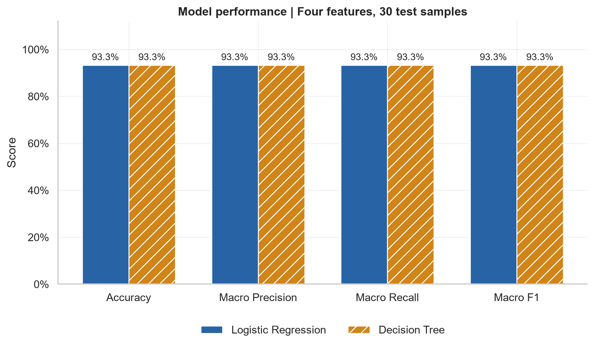

# Datheon · Machine Learning & Data Science Internship

**Arafat Rahman** · Application ID: `DT-2026-JTNGO`

Completed projects cover Iris classification, California housing regression and customer churn classification. Each includes an executed notebook, data checks, leakage-free preprocessing, saved evaluation results and diagnostic figures.

[Open the executed notebook](Task_01_Classification/iris_classification.ipynb) · [Official task requirements](https://www.datheon.in/training/catalog/machine-learning-and-data-science-internship)

## Projects

| Project | Status | Open |
|:--|:--|:--|
| Iris Classification | Completed | [Notebook](Task_01_Classification/iris_classification.ipynb) |
| Housing Price Prediction | Completed | [Overview and results](Task_02_Housing_Price_Prediction/README.md) · [Notebook](Task_02_Housing_Price_Prediction/housing_price_prediction.ipynb) |
| Customer Churn Classification | Completed | [Overview and results](Task_03_Customer_Churn_Classification/README.md) · [Notebook](Task_03_Customer_Churn_Classification/customer_churn_classification.ipynb) |
| Sentiment Classification | Pending | [Folder](Task_04_Sentiment_Classification/) |

## Customer churn results

| Model | ROC-AUC | Average precision | Accuracy | Precision | Recall | F1 |
|:--|--:|--:|--:|--:|--:|--:|
| Random Forest | 0.8350 | 0.6357 | 0.7608 | 0.5358 | 0.7406 | 0.6218 |
| XGBoost | 0.8463 | 0.6669 | 0.7509 | 0.5204 | 0.7861 | 0.6262 |

Five-fold training CV selected XGBoost. Both models exceed 0.80 held-out ROC-AUC; XGBoost catches more churners with more false positives. See the [project documentation](Task_03_Customer_Churn_Classification/README.md) for evaluation, limitations and execution.

## Task 2 results

| Model | Test RMSE (USD) | Test MAE (USD) | Test R² | CV RMSE (USD) | Alpha |
|:--|--:|--:|--:|--:|--:|
| OLS | 68,845.00 | 49,458.67 | 0.6383 | 67,675.28 | — |
| Ridge | 68,897.95 | 49,469.16 | 0.6378 | 67,663.06 | 10 |
| Lasso | 68,937.05 | 49,426.84 | 0.6373 | 67,660.87 | 100 |

Training CV selected Lasso; OLS had a slightly lower test RMSE. Both conclusions are reported without test-driven tuning. See the [Housing Price Prediction documentation](Task_02_Housing_Price_Prediction/README.md) for methodology, plots, limitations and execution instructions.

## Task 1 results

Four-feature models evaluated on the same **30 held-out samples**:

| Model | Accuracy | Macro precision | Macro recall | Macro F1 |
|:--|--:|--:|--:|--:|
| Logistic Regression | 93.33% | 93.33% | 93.33% | 93.33% |
| Decision Tree | 93.33% | 93.33% | 93.33% | 93.33% |

Both models correctly classified **28 of 30** test examples and made the same two errors. There is no observed performance advantage on this split. Setosa achieved precision, recall and F1 of 1.00; versicolor and virginica each achieved 0.90, with support of 10 per species.



## Dataset

Source: [Iris CSV linked by Datheon](https://raw.githubusercontent.com/mwaskom/seaborn-data/master/iris.csv), hosted in the Seaborn data repository.

- 150 samples, four numeric features measured in centimetres and one target column.
- Features: sepal length, sepal width, petal length and petal width.
- Species: setosa, versicolor and virginica; 50 samples each.
- No missing values. One repeated row beyond its first occurrence is retained to preserve the benchmark.
- No identical feature vectors occur across training and test partitions in this split.
- The notebook downloads the CSV into memory and prints its SHA-256 fingerprint. No fallback dataset was used.

## Methodology

1. Validate the dataset shape, column names, numeric types, finite values, class labels, missingness and duplicates.
2. Summarize measurements and visualize class balance and pairwise feature distributions.
3. Use `train_test_split(test_size=0.20, stratify=y, random_state=42)`: 120 training samples and 30 test samples, with 40/10 samples per species.
4. Fit `StandardScaler` only on training data. Transform the training and test features with that fitted scaler for Logistic Regression.
5. Train `LogisticRegression(max_iter=1000, random_state=42)` and `DecisionTreeClassifier(random_state=42)`. The tree uses unscaled features because threshold splits do not require standardization.
6. Calculate accuracy, macro precision, macro recall, macro F1, per-class reports and confusion matrices. Macro metrics weight each species equally.
7. Inspect every test error. Separate two-feature models illustrate decision boundaries using petal length and width; these do not generate the reported four-feature metrics.

No model tuning or feature selection is performed using held-out results. EDA is descriptive; model settings and features are fixed in advance.

## Repository structure

```text
Machine_Learning_Data_Science_Internship/
├── Task_01_Classification/
│   ├── iris_classification.ipynb
│   ├── results/
│   │   ├── model_comparison.csv
│   │   └── classification_reports.txt
│   └── figures/
│       ├── iris_pairplot.png
│       ├── class_distribution.png
│       ├── confusion_matrix_logistic_regression.png
│       ├── confusion_matrix_decision_tree.png
│       ├── model_comparison.png
│       └── decision_boundaries.png
├── Task_02_Housing_Price_Prediction/
│   ├── housing_price_prediction.ipynb
│   ├── README.md
│   ├── results/
│   └── figures/
├── Task_03_Customer_Churn_Classification/
│   ├── customer_churn_classification.ipynb
│   ├── README.md
│   ├── results/
│   └── figures/
├── Task_04_Sentiment_Classification/
│   └── README.md                 # Pending
├── README.md
├── requirements.txt
└── .gitignore
```

## Environment and installation

Tested with **Python 3.12.10 on Windows**. Dependencies are pinned in `requirements.txt`: NumPy, Pandas, SciPy, Scikit-learn, Matplotlib, Seaborn and the Jupyter execution tools.

Run these PowerShell commands from the repository root on a new machine:

```powershell
python -m venv .venv
.\.venv\Scripts\python.exe -m pip install -r requirements.txt
.\.venv\Scripts\python.exe -m ipykernel install --user --name datheon-task1 --display-name "Python (Datheon Task 1)"
```

Activation is unnecessary: invoking the environment's Python directly avoids PowerShell activation-script restrictions. The `.venv` folder is ignored by Git.

## Run the notebook

In VS Code, open `Task_01_Classification/iris_classification.ipynb`, select **Python (Datheon Task 1)** and choose **Run All**.

Alternatively, launch Jupyter:

```powershell
.\.venv\Scripts\python.exe -m jupyter lab Task_01_Classification/iris_classification.ipynb
```

Execute and save all outputs from PowerShell:

```powershell
.\.venv\Scripts\python.exe -m jupyter nbconvert --to notebook --execute --inplace Task_01_Classification/iris_classification.ipynb --ExecutePreprocessor.timeout=180
```

The notebook supports the repository root and the Task 1 folder as working directories. Internet access is required to download the source CSV. Rerunning regenerates the eight results and figure files.

## Figures and saved results

| File | Purpose |
|:--|:--|
| `iris_pairplot.png` | Feature histograms and pairwise relationships, grouped by species |
| `class_distribution.png` | Samples per class |
| `confusion_matrix_logistic_regression.png` | Four-feature Logistic Regression test predictions |
| `confusion_matrix_decision_tree.png` | Four-feature Decision Tree test predictions |
| `model_comparison.png` | Common-scale accuracy and macro metrics |
| `decision_boundaries.png` | Separate two-feature illustration models with training points only |
| `model_comparison.csv` | Full-precision calculated aggregate metrics |
| `classification_reports.txt` | Per-class metrics, macro/weighted averages and support |

## Error analysis and limitations

Both classifiers misclassified source row 77 (versicolor → virginica) and row 134 (virginica → versicolor), using zero-based CSV indices. The notebook shows their feature values. These errors do not establish a causal explanation or justify tuning against the test set.

- The balanced benchmark is small and does not represent arbitrary real-world populations.
- A single 30-sample test split does not measure variability across splits. One changed prediction alters accuracy by about 3.33 percentage points.
- Repeated source measurements are retained, with an explicit train/test overlap check.
- Boundary plots use two features and must not be read as visualizations of the four-feature evaluation models.
- The upstream CSV is branch-based and could change; the saved notebook records the exact source fingerprint.

## Task 1 verification and overall progress

The notebook completed **two sequential runs in separate fresh kernels**, including execution from both supported working directories. All 19 code cells passed. The eight generated artifacts were byte-identical across runs. Metrics were independently checked against confusion-matrix counts, and all six saved figures were visually inspected. The full notebook HTML was exported, but a browser preview was unavailable in the execution environment.

- [x] Task 1 — Iris classification: implemented, executed and verified
- [x] [Task 2 — Housing Price Prediction](Task_02_Housing_Price_Prediction/) — Implemented, executed and verified
- [x] [Task 3 — Customer Churn Classification](Task_03_Customer_Churn_Classification/) — Implemented, executed and verified
- [ ] [Task 4 — Sentiment Classification](Task_04_Sentiment_Classification/) — Pending

Task completion here records implementation and local verification only. Datheon review and approval are not claimed; no certificate has been issued through this project, and the final internship form has not been submitted.
