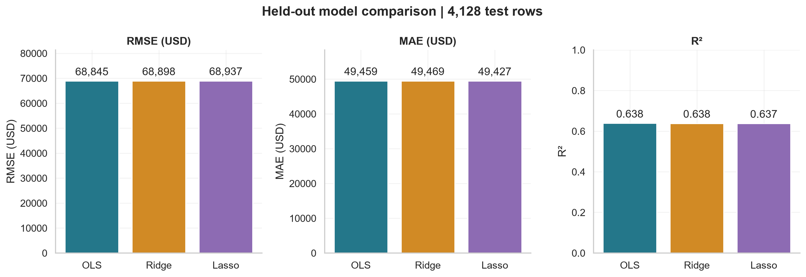

# Housing Price Prediction

Compare OLS, Ridge and Lasso on California housing data using reproducible feature engineering, fold-specific preprocessing and held-out evaluation.

[Executed notebook](housing_price_prediction.ipynb) · [Official requirements](https://www.datheon.in/training/catalog/machine-learning-and-data-science-internship) · [Back to internship overview](../README.md)

## Results

| Model | Test RMSE (USD) | Test MAE (USD) | Test R² | CV RMSE (USD) | Alpha |
|:--|--:|--:|--:|--:|--:|
| OLS | 68,845.00 | 49,458.67 | 0.6383 | 67,675.28 | — |
| Ridge | 68,897.95 | 49,469.16 | 0.6378 | 67,663.06 | 10 |
| Lasso | 68,937.05 | 49,426.84 | 0.6373 | 67,660.87 | 100 |


Training-only five-fold CV selected **Lasso (alpha = 100)**. OLS had the lowest observed test RMSE; the difference is small and does not establish general superiority. The test set was not used for tuning or changing the selected model. The training-mean baseline test RMSE was **$114,485.64**.



## Data and method

- Source: [California housing CSV linked by Datheon](https://raw.githubusercontent.com/ageron/handson-ml2/master/datasets/housing/housing.csv).
- 20,640 area-level rows; eight numeric predictors, `ocean_proximity` and the target `median_house_value` in US dollars.
- 207 missing bedroom values; no duplicate rows. All rows are retained.
- Split: **16,512 training / 4,128 test**, `test_size=0.20`, `random_state=42`. EDA uses training rows only.
- Features: rooms per household, bedrooms per room, population per household, income × rooms and income × age, plus the original predictors.
- Numeric median imputation and scaling, categorical most-frequent imputation and one-hot encoding are fitted inside each training fold. Dropping one category avoids dummy-column redundancy with the intercept.
- Identical seeded five-fold CV for all models. Ridge alpha grid: `0.01, 0.1, 1, 10, 100, 1000, 10000`; Lasso: `0.1, 1, 10, 100, 1000, 10000`.
- `GridSearchCV` selects alpha using RMSE. Convergence warnings are treated as errors. The best estimator is refitted on the full training set.
- Correlations, design-matrix rank/conditioning and fitted coefficients document multicollinearity. Ridge and Lasso penalize coefficients; no causal interpretation is made.

## Files

```text
Task_02_Housing_Price_Prediction/
├── housing_price_prediction.ipynb
├── README.md
├── results/
│   ├── model_comparison.csv
│   ├── alpha_search.csv
│   ├── test_predictions.csv
│   ├── coefficients.csv
│   ├── largest_errors.csv
│   └── run_summary.json
└── figures/
    ├── training_distributions.png
    ├── correlation_heatmap.png
    ├── alpha_search.png
    ├── model_comparison.png
    ├── predicted_vs_actual.png
    ├── residual_analysis.png
    └── coefficients.png
```

The results folder contains tables and a compact run summary; the notebook is kept separately. Predictions retain original zero-based source row indices for auditing. No raw dataset or trained-model binary is committed.

## Run

Use the shared [requirements](../requirements.txt), tested with Python 3.12.10. From the repository root in PowerShell:

```powershell
python -m venv .venv
.\.venv\Scripts\python.exe -m pip install -r requirements.txt
.\.venv\Scripts\python.exe -m ipykernel install --user --name housing-price-prediction --display-name "Python (Housing Price Prediction)"
.\.venv\Scripts\python.exe -m jupyter nbconvert --execute --to notebook --inplace Task_02_Housing_Price_Prediction/housing_price_prediction.ipynb --ExecutePreprocessor.timeout=600
```

In VS Code, open the notebook, choose **Python (Housing Price Prediction)** and use **Run All**. Internet is required for the source CSV. The notebook also supports Kaggle's `/kaggle/working` directory. Rerunning regenerates all results and figures.

## Interpretation and limits

The models perform similarly. Residuals show long tails and systematic structure, while the target piles up at $500,001. A random area-level split does not establish performance in unseen regions, future years or individual-property pricing. Extreme ratios and rare categories remain visible in the diagnostics. Negative predictions are reported, not silently clipped. CV fold standard deviations are not confidence intervals.

## Verification

All 19 code cells completed in two fresh-kernel runs, from the Task 2 directory and repository root. All 13 generated artifacts were byte-identical. Metrics were independently recomputed from saved predictions; fitted medians and scaler sample counts were checked against training rows. All seven charts were visually inspected. Full notebook browser preview was not available.

**Status: Completed and locally verified.** This does not claim Datheon approval or certification. Tasks 3 and 4 remain pending.
