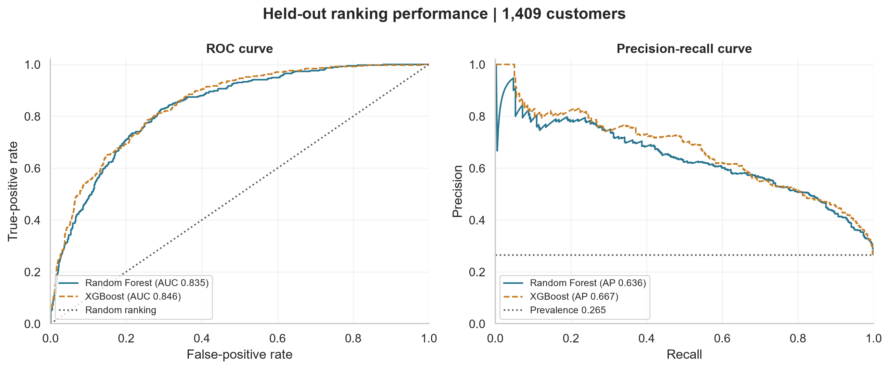

# Customer Churn Classification

**Arafat Rahman** · Datheon Machine Learning & Data Science Internship · Application `DT-2026-JTNGO`

[Executed notebook](customer_churn_classification.ipynb) · [Kaggle notebook](https://www.kaggle.com/code/arafat1746/customer-churn-classification)

Predict customer churn using Random Forest and XGBoost, with categorical preprocessing, class weighting, cross-validation and held-out evaluation. This implements Task 3 of the [official internship requirements](https://www.datheon.in/training/catalog/machine-learning-and-data-science-internship).

## Dataset and preparation

The [IBM Telco Customer Churn CSV](https://raw.githubusercontent.com/IBM/telco-customer-churn-on-icp4d/master/data/Telco-Customer-Churn.csv) contains **7,043 customers**, 19 predictors, a customer identifier and the churn target. There are 1,869 churners (26.54%) and 5,174 non-churners. The notebook validates the schema, labels, IDs and missingness, and records the downloaded source SHA-256.

`TotalCharges` is converted to numeric; 11 blank entries become missing values. Customer IDs are excluded from modeling. Distinct customer records are retained even when their recorded profiles match. No bundled or synthetic substitute is used.

## Methodology

- An 80/20 stratified split with `random_state=42` gives **5,634 training** and **1,409 test** customers; the test set contains 374 churners and 1,035 non-churners.
- Pipelines impute numeric features with training medians and categorical features with training modes. `OneHotEncoder(handle_unknown="ignore")` encodes categories. Trees do not need feature scaling.
- Five-fold stratified training CV uses identical folds for both algorithms. Every fold fits its own preprocessing and imbalance weights. Random Forest uses `class_weight="balanced"`; XGBoost calculates `scale_pos_weight` from the current fit's labels.
- Random Forest uses 300 trees, depth 12, minimum leaf size 5 and `max_features=0.7`. XGBoost uses 300 trees, depth 3, learning rate 0.05, row/column subsampling 0.8 and L2 regularization 5. Seeds are fixed at 42.
- Settings are fixed in advance. Mean CV ROC-AUC selects XGBoost (0.8473 versus 0.8409), before evaluating the held-out test data. No test-driven tuning is performed.
- Both classifiers use a fixed 0.5 threshold. Precision, recall and F1 below refer to the positive churn class; full per-class reports include support and macro/weighted averages.

## Actual held-out results

| Model | ROC-AUC | Average precision | Accuracy | Precision | Recall | F1 |
|:--|--:|--:|--:|--:|--:|--:|
| Random Forest | 0.8350 | 0.6357 | 0.7608 | 0.5358 | 0.7406 | 0.6218 |
| XGBoost | 0.8463 | 0.6669 | 0.7509 | 0.5204 | 0.7861 | 0.6262 |

Both models exceed the assignment's **0.80 ROC-AUC** target on this split. XGBoost has higher ROC-AUC, average precision and churn recall; Random Forest has higher accuracy and precision. This does not establish universal algorithm superiority.

Random Forest produces **240 false positives and 97 false negatives** (337 errors). XGBoost produces **271 false positives and 80 false negatives** (351 errors): it identifies 17 additional churners but flags 31 additional non-churners. Error exports use source row indices rather than customer identifiers.


### Kaggle execution

The public Kaggle run completed successfully and generated all six figures and eight result files. Its downloaded predictions were independently checked against its metrics; the dataset fingerprint and held-out row indices match the local run. The managed Kaggle runtime yields slightly different fitted results, so the local table above is not presented as the Kaggle result. Cross-platform equivalence is not assumed.

| Model | Kaggle ROC-AUC | Accuracy | Precision | Recall | F1 |
|:--|--:|--:|--:|--:|--:|
| Random Forest | 0.8364 | 0.7779 | 0.5650 | 0.7086 | 0.6287 |
| XGBoost | 0.8460 | 0.7544 | 0.5248 | 0.7914 | 0.6311 |

## Figures

| Figure | Purpose |
|:--|:--|
| `class_distribution.png` | Training-set class imbalance |
| `training_exploration.png` | Training-only contract and tenure exploration |
| `roc_precision_recall.png` | Test ROC and precision-recall curves with baselines |
| `confusion_matrices.png` | Both models at the fixed decision threshold |
| `model_comparison.png` | Common-scale held-out metric comparison |
| `feature_importances.png` | Top 10 encoded features per model; impurity importance for Random Forest and gain for XGBoost |



## Files

```text
Task_03_Customer_Churn_Classification/
├── customer_churn_classification.ipynb
├── README.md
├── figures/                         # Six PNG figures
└── results/
    ├── cross_validation.csv
    ├── model_comparison.csv
    ├── test_predictions.csv
    ├── classification_reports.txt
    ├── feature_importances.csv
    ├── error_counts.csv
    ├── misclassified_customers.csv
    └── run_summary.json
```

## Run the notebook

Tested with Python 3.12.10 and the pinned versions in the root `requirements.txt`, including XGBoost 3.4.1. From the repository root in PowerShell:

```powershell
python -m venv .venv
.venv\Scripts\python.exe -m pip install -r requirements.txt
.venv\Scripts\python.exe -m ipykernel install --user --name customer-churn-classification --display-name "Python (Customer Churn Classification)"
.venv\Scripts\python.exe -m jupyter nbconvert --execute --to notebook --inplace Task_03_Customer_Churn_Classification/customer_churn_classification.ipynb --ExecutePreprocessor.timeout=600
```

Alternatively open the notebook in VS Code with Microsoft's Jupyter extension and select that kernel. Internet access is required for the source CSV. Paths support execution from the repository root, task folder and Kaggle working directory.

## Verification and limitations

All **17 code cells** executed sequentially in two fresh local kernels. Saved CSV results reproduced within numerical tolerance of 1e-12. Metric assertions cross-check predictions and confusion-matrix counts. All six figures and eight results files were generated, and the figures were visually inspected; a full browser notebook preview was unavailable.

This static dataset and random holdout do not establish performance on future customers. Twelve identical predictor profiles occur across training and test partitions for different customer IDs, which can make random-split estimates optimistic. A temporal or grouped evaluation would be preferable when suitable identifiers and dates are available. Class weighting does not calibrate probability estimates; operational thresholds need validation against intervention costs. Native feature importances are not causal explanations and cannot be compared directly across algorithms. The upstream URL is branch-based; its recorded fingerprint identifies this run's source.

Task 3 implementation and local verification are complete. [Task 4 is also complete](../Task_04_Sentiment_Classification/README.md). No Datheon approval, certification or final-form submission is claimed.
