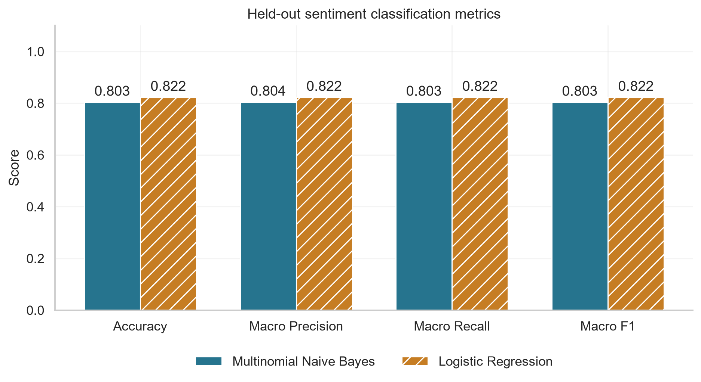

# Sentiment Classification

**Arafat Rahman** · Datheon Machine Learning & Data Science Internship · Application `DT-2026-JTNGO`

[Executed notebook](sentiment_classification.ipynb) · [Kaggle notebook](https://www.kaggle.com/code/arafat1746/sentiment-classification)

Classify English review sentences using TF-IDF, Multinomial Naive Bayes and Logistic Regression. Includes data checks, reproducible preprocessing, held-out evaluation, error analysis and a custom-text prediction helper. Implements [Task 4 requirements](https://www.datheon.in/training/catalog/machine-learning-and-data-science-internship).

## Source and data quality

**Source substitution:** the [official dataset URL](https://raw.githubusercontent.com/datasets/sample-reviews/main/sentiment_reviews.csv) returned HTTP 404 on 25 October 2026. This project instead uses [UCI Sentiment Labelled Sentences](https://archive.ics.uci.edu/dataset/331/sentiment+labelled+sentences). This substitution is explicit in the notebook and execution summary.

Attribution: Kotzias, D. (2015), *Sentiment Labelled Sentences*, UCI Machine Learning Repository, [DOI: 10.24432/C57604](https://doi.org/10.24432/C57604), CC BY 4.0.

The archive contains **3,000 sentences** across Amazon, IMDb and Yelp, with 500 positive and 500 negative examples per source. Its SHA-256 is recorded in `results/run_summary.json`. The loader preserves embedded quotation marks and Unicode line separators. Cleaning leaves two empty texts; these and 73 repeated normalized texts are removed. No conflicting-label normalized groups occur. The final dataset has **2,925 sentences**, split into **2,340 training** and **585 test** rows with stratification and `random_state=42`. No cleaned text is shared across the partitions.

## Methodology

1. Decode HTML entities, remove HTML tags, lowercase and normalize negative contractions.
2. Tokenize alphabetic words with regex, remove NLTK English stopwords while retaining negations, and apply WordNet noun lemmatization.
3. Fit `TfidfVectorizer(max_features=5000, ngram_range=(1,2))` inside each training pipeline. Vocabulary and IDF use training text only.
4. Fit `MultinomialNB(alpha=1.0)` and `LogisticRegression(C=1.0, max_iter=1000, random_state=42)` on the same training rows.
5. Evaluate accuracy, macro precision/recall/F1, full per-class reports and confusion matrices. Export predictions, errors and domain-level performance. The majority-label baseline uses the training majority.

Settings are fixed; no hyperparameter search or model selection uses the test set. Logistic Regression is the predefined custom-helper default.

## Actual local results

| Model | Accuracy | Macro precision | Macro recall | Macro F1 |
|:--|--:|--:|--:|--:|
| Multinomial Naive Bayes | 0.8034 | 0.8039 | 0.8034 | 0.8033 |
| Logistic Regression | 0.8222 | 0.8223 | 0.8222 | 0.8222 |

Logistic Regression correctly classified **481/585** test sentences, compared with **470/585** for Naive Bayes. It has higher observed accuracy and macro F1 on this split, but this single comparison does not establish general superiority. The majority-label baseline accuracy is **50.09%**.



## Custom prediction

After running all notebook cells, edit and rerun the example cell or call:

```python
predict_sentiment("The food was delicious and the staff were helpful.")
predict_sentiment("The movie was disappointing.", model_name="Multinomial Naive Bayes")
```

The helper applies the fitted pipeline and returns sentiment, a positive-class score and the model name. Empty or completely unknown vocabulary returns `Unknown`. Scores are not calibrated confidence; neutral and mixed sentiment are not separately modeled. Demonstration phrases are not evaluation data.

## Files

```text
Task_04_Sentiment_Classification/
├── sentiment_classification.ipynb
├── README.md
├── figures/
│   ├── training_exploration.png
│   ├── confusion_matrices.png
│   ├── model_comparison.png
│   └── sentiment_terms.png
└── results/
    ├── model_comparison.csv
    ├── classification_reports.txt
    ├── test_predictions.csv
    ├── term_coefficients.csv
    ├── misclassified_reviews.csv
    ├── domain_performance.csv
    └── run_summary.json
```

Training charts describe class balance and token counts. The confusion matrices show test errors; the comparison chart uses a common score scale. The term chart shows the ten strongest positive and negative Logistic Regression coefficients, which are associations rather than causal explanations.

## Installation and execution

Tested on Windows with Python 3.12.10. Exact direct dependencies are pinned in the root `requirements.txt`, including NLTK 3.10.4. From the repository root in PowerShell:

```powershell
python -m venv .venv
.venv\Scripts\python.exe -m pip install -r requirements.txt
.venv\Scripts\python.exe -m ipykernel install --user --name sentiment-classification --display-name "Python (Sentiment Classification)"
.venv\Scripts\python.exe -m jupyter nbconvert --execute --to notebook --inplace Task_04_Sentiment_Classification/sentiment_classification.ipynb --ExecutePreprocessor.timeout=600
```

Or open the notebook in VS Code with Microsoft's Jupyter extension and select this kernel. Internet access is needed for the UCI archive and NLTK `stopwords`/`wordnet` resources. Execution supports the repository root, task folder and Kaggle working directory. Raw datasets and downloaded language resources are not committed.

## Validation and limitations

The public Kaggle execution completed successfully. Its downloaded test predictions, aggregate metrics and source summary match the local execution; all four figures and seven result files were verified. GitHub publication was checked against local file hashes.

All 14 code cells executed in two fresh local kernels; saved CSV results reproduced within 1e-12 numerical tolerance. Assertions check schema, class counts, normalized-text separation, training-only vocabulary, metrics against confusion-matrix counts, custom-helper edge cases and all 11 generated artifacts. Four saved figures were visually inspected. The HTML preview was exported outside the repository; full browser-page inspection was not performed.

The data consists of selected binary English sentences and excludes neutral examples. Results do not establish reliability on full reviews, sarcasm, mixed sentiment, other languages or future domains. Noun-only lemmatization and stopword removal can discard context. Related source reviews may remain despite normalized deduplication because original review IDs are unavailable. Domain scores are subsets of the same holdout, not tests on unseen domains. The small random holdout does not quantify uncertainty across splits.

Task 4 implementation is complete. No Datheon approval or certificate is claimed, and the final internship form has not been submitted.
